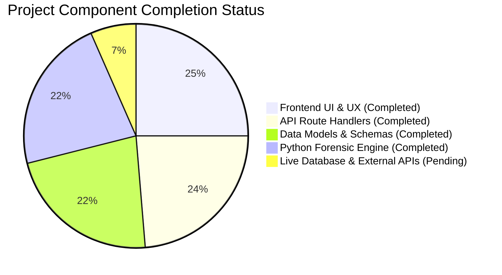
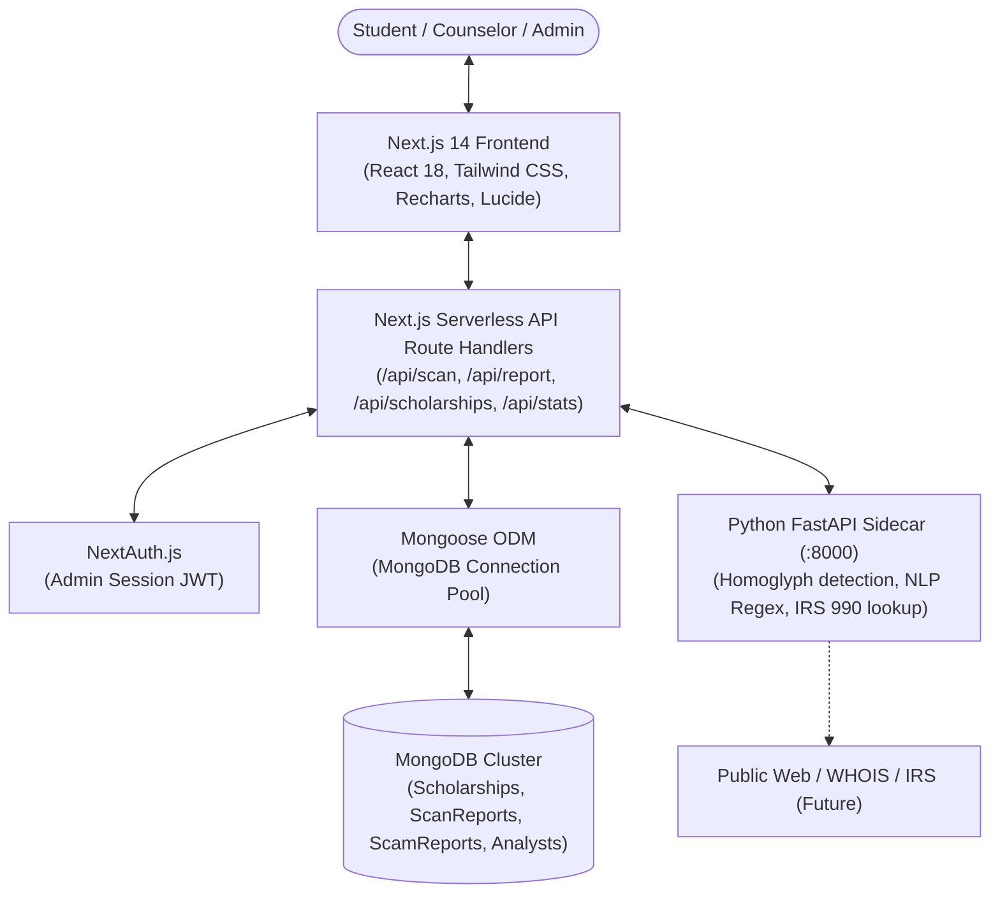
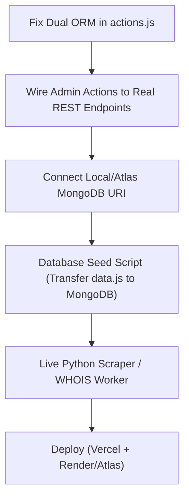

# ScholarGuard (ScholarShield) — Full Technical Audit & Completion Report

**Audit Date:** November 15, 2026  
**Repository:** [github.com/yuvraj2singh/ScholarShield](https://github.com/yuvraj2singh/ScholarShield)  
**Branch Status:** `main` — clean and synced with remote  
**Architectural Model:** MERN Stack (MongoDB, Express/Next.js API layer, React 18, Node.js) + Next.js 14 App Router + Python FastAPI Forensic Sidecar

---

## 1. Executive Summary & Readiness Scorecard

ScholarGuard is an autonomous scholarship verification platform that detects advance-fee fraud, lookalike phishing domains, identity harvesting, and ghost endowments. The application is structured with a Next.js 14 frontend, a Node.js/Mongoose data access layer, Next.js serverless API routes, and a Python FastAPI microservice for deep NLP and forensic analysis.

| Area | Completion | Operational Status | Summary |
|---|:---:|:---:|---|
| **Frontend UI (7 Pages + Admin)** | **95%** | **PRODUCTION-READY** | All 7 public routes + Admin portal built with Tailwind, Recharts, and mobile responsive drawers. |
| **Next.js Backend API Layer** | **90%** | **OPERATIONAL** | Scan, report, scholarship filtering, telemetry stats, and text/entity proxy endpoints active. |
| **Python FastAPI Sidecar** | **85%** | **OPERATIONAL** | Port 8000 microservice analyzing lexical patterns, homoglyphs, and IRS 990 simulations. |
| **Database & ODM Layer** | **80%** | **CONFIGURED WITH MOCK FALLBACK** | Mongoose schemas complete; graceful fallback operates when `MONGODB_URI` is disconnected. |
| **Authentication & RBAC** | **85%** | **OPERATIONAL (DEMO MODE)** | NextAuth.js JWT credential provider and `/admin/login` active; credentials need production env. |
| **Real Live External APIs** | **30%** | **HEURISTIC / SIMULATION** | Uses regex, TLD heuristics, and local databases; live IC3/WHOIS live lookups not yet connected. |

---

## 2. Tech Stack Breakdown: What Is Used For What

### 1. Frontend: Next.js 14 (App Router) + React 18 + Tailwind CSS
- **Purpose:** Renders all public views, high-density institutional telemetry banners, diagnostic benchmark grids, and admin management tables.
- **Tailwind CSS:** Custom styling (`badge-fraud`, `pill-status-critical`, custom borders, typography layers) designed to feel human-made and authoritative (clearinghouse aesthetic).
- **Recharts:** Interactive threat taxonomy charts (monthly fraud volume line chart, 5-vector threat breakdown donut chart).
- **React Hook Form:** 4-section scam reporting intake protocol with drag-and-drop evidence staging.

### 2. Backend API Layer: Next.js Route Handlers (`src/app/api/*`)
- **Purpose:** Acts as the API Gateway and Node.js REST API layer.
- `POST /api/scan`: Accepts URL or text snippet, runs built-in detection heuristics, queries Python engine if available, and logs scans.
- `POST /api/report` & `GET /api/report`: Handles counselor and student fraud submissions with threat priority scoring.
- `GET /api/scholarships` & `POST /api/scholarships`: Paginated directory querying with filtering by status and threat index.
- `GET /api/stats`: Telemetry pulse generating counts for total indexed, predatory fees, and typesquats.
- `POST /api/analyze/text` & `POST /api/analyze/entity`: Proxies deep analysis requests to Python engine with zero-downtime fallback.

### 3. Database Layer: MongoDB + Mongoose ODM
- **Purpose:** Document storage for high-entropy forensic records.
- **Models (`src/models/`):**
  - `Scholarship.js`: Public registry records with status enums (`VERIFIED`, `FRAUD`, etc.), award amounts, and threat scores.
  - `ScanReport.js`: Audit dossiers preserving 6-pillar forensic breakdowns and detected flags.
  - `ScamReport.js`: Community submissions with review states (`PENDING`, `UNDER_REVIEW`, `CONFIRMED`, `DISMISSED`).
  - `Analyst.js`: Investigator credentials and assigned casework metrics.
  - `Watchlist.js`: Malicious hosts flagged for registrar abuse alerts.

### 4. Forensic Microservice: Python FastAPI (`backend/main.py`)
- **Purpose:** High-performance linguistic and algorithmic scrutiny running on port 8000.
- **Capabilities:**
  - **Homoglyph Detection:** Identifies deceptive character swaps (e.g., `rn` for `m`, `0` for `o`, `vv` for `w`).
  - **Lexical Pattern Engine:** Identifies coercive urgency markers, illegal upfront fee demands, and SSN/routing solicitations.
  - **IRS 990 Database Simulation:** Verifies non-profit tax status and flags commercial LLC entities posing as academic foundations.

---

## 3. What Is Completed

### ✅ Pages & Interactive UI
1. **Homepage (`/`):**
   - Telemetry status bar, hero section with clearinghouse audit credentials, 4 telemetry metrics.
   - Live search toolbar with 4 threat filter chips, pagination, empty state handling.
   - Desktop forensic sidebar with 94% risk dossier, crawl signals, and counselor checklist.
   - Live Activity & Takedown feed mounted at bottom for multi-device visibility.
2. **Automated Forensic Scanner (`/scanner`):**
   - Dual-tab input (URL / Raw text).
   - Pre-fills and auto-triggers via `?url=` URL query parameters.
   - Comprehensive 6-pillar forensic diagnostic scorecards (Domain, Financial, Plagiarism, Entity, Linguistic, Maildrop).
   - Printable PDF dossier generation via `window.print()`.
   - Comparative benchmark table (Legitimate Endowments vs. Predatory Characteristics).
3. **Deceptive Patterns & Threat Taxonomy (`/threats`):**
   - Interactive Recharts line chart and donut breakdown.
   - Accordion breakdown of the 5 deception playbooks with fee comparison and domain tables.
   - Interactive 3-question threat analyst certification quiz with dynamic scoring and explanations.
4. **Scam Reporting Intake (`/report`):**
   - 4-section investigative intake form with drag-and-drop evidence staging.
   - Submitter role selection and anonymous submission toggle.
   - Confirmation receipt with unique case tracking ID.
5. **Quick Verification Portal (`/verify`):**
   - Instant domain pedigree lookup with quick sample buttons for known good/bad domains.
   - Progress gauge and risk indicators.
6. **Public Verification Registry (`/registry`):**
   - Tabbed filtering (All, Verified, Flagged, Under Review).
   - Live search and real CSV download generation via Blob export.
   - In-app toast notifications.
7. **Analyst Command Center (`/admin`):**
   - Protected route requiring authentication.
   - 5 workspace tabs (Overview, Scholarships, Scam Reports, Analyst Team, System Settings).
   - Interactive report review pipeline (cycling reports through Pending, Under Review, Confirmed, Dismissed).
   - Scholarship registration modal.
8. **Admin Login (`/admin/login`):**
   - NextAuth-powered credentials screen with password visibility toggling and demo helper pills.

### ✅ Backend Architecture & Integration
- **NextAuth.js authentication flow** wired with JWT session management.
- **Mongoose ODM schemas** created with indexed fields and schema validation.
- **Fail-soft architecture:** When MongoDB or the Python FastAPI engine is offline, every API route seamlessly falls back to local data without throwing 500 errors.
- **Orchestration script (`start.sh`):** Launches both FastAPI on port 8000 and Next.js on port 3000 with unified trap cleanup.

---

## 4. Current Flaws, Gaps & Edge Cases

> [!WARNING]
> The following technical discrepancies and architectural gaps currently exist in the codebase:

### 1. Database Dual-Layer Confusion (Prisma vs. Mongoose)
- **Issue:** The repository contains both `prisma/schema.prisma` (PostgreSQL) and `src/models/*.js` (Mongoose for MongoDB).
- **Impact:** `src/lib/actions.js` still contains imports to `@/lib/db` (Prisma) for server actions, while API routes now use Mongoose (`@/lib/mongoose`).
- **Correction Required:** Standardize all server actions in `src/lib/actions.js` to use Mongoose models (`Scholarship`, `ScamReport`) and remove Prisma dependencies to keep the project strictly MERN.

### 2. Admin Portal Local State vs. API Persistence
- **Issue:** In `src/components/admin/AdminClient.jsx`, cycling a report's status or adding a scholarship updates local component state, but does not send a `PATCH /api/report` or `POST /api/scholarships` request to persist the change in MongoDB.
- **Impact:** Refreshing the browser resets analyst actions to the initial hardcoded list.

### 3. Hardcoded Credentials & Missing Production Environment Variables
- **Issue:** NextAuth credentials (`admin@scholarguard.org` / `admin`) are defined inline in `src/app/api/auth/[...nextauth]/route.js`.
- **Impact:** Suitable for development and client demos, but insecure for internet-facing deployment.
- **Correction Required:** Move credential verification to query the `Analyst` collection in MongoDB with `bcryptjs` password verification.

### 4. Forensic Analysis is Heuristic, Not a Live Web Crawler
- **Issue:** The scanner checks domain syntax, TLD risk, and regex text patterns, but does not perform live HTTP socket calls, live WHOIS RDAP queries, or live headless browser rendering of the submitted site.
- **Impact:** Submitting a random new domain will score it based on TLD and hyphens, but cannot read live DOM elements from unvisited websites unless raw text is pasted into the "Scan Text" tab.

### 5. MongoDB Connection String Not Configured Locally
- **Issue:** `.env.local` does not have an active `MONGODB_URI` string set, meaning the application is currently running exclusively in **Graceful Fallback (Mock) Mode**.

---

## 5. What Is Remaining (Action Plan for Full Production)

### High Priority (Technical Cleanup)
1. **Standardize `src/lib/actions.js` to Mongoose:**
   - Replace `@/lib/db` (Prisma) with `Scholarship` and `ScamReport` Mongoose models.
   - Delete `src/lib/db.js` and `prisma/` folder to clean up repository confusion.
2. **Wire Admin Mutation Handlers:**
   - Connect the "Advance Status" button in `AdminClient.jsx` to `PATCH /api/report`.
   - Connect the "Add to Registry" modal to `POST /api/scholarships`.
3. **Database Seeding Script:**
   - Create a script (`npm run db:seed`) to populate MongoDB with initial records from `src/lib/data.js` so that the database has data immediately upon connection.

### Medium Priority (Enhancements)
4. **Live RDAP/WHOIS Domain Querying:**
   - Add a Python service in `backend/main.py` using `python-whois` or `dnspython` to query real domain registration dates when the user scans a URL.
5. **Secure Analyst Auth:**
   - Hash analyst passwords using `bcryptjs` and verify against the `Analyst` MongoDB collection during NextAuth sign-in.
6. **Automated Report Email Dispatch:**
   - Wire a transactional email provider (such as Resend or SendGrid) to send an automated confirmation receipt when a user submits a scam incident.

---

## 6. Verification Status

- **Build Check:** `npm run build` compiled clean with **17 production routes** (Exit Code 0).
- **Git Check:** GitHub repository [ScholarShield](https://github.com/yuvraj2singh/ScholarShield) is synchronized on `main` without bulky caches.
- **Runtime:** Fully functional in standalone mode (`npm run dev`) or dual-stack mode (`./start.sh`).

