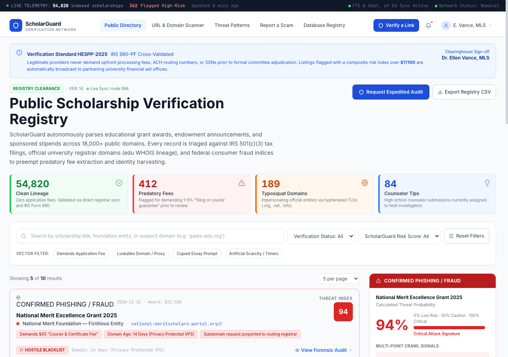
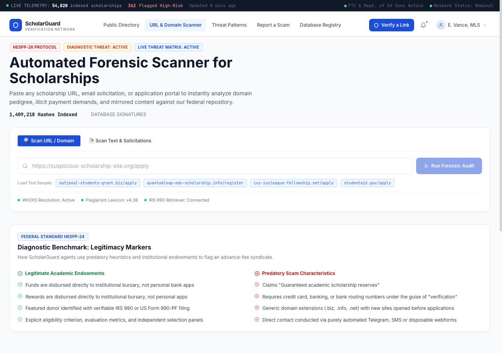
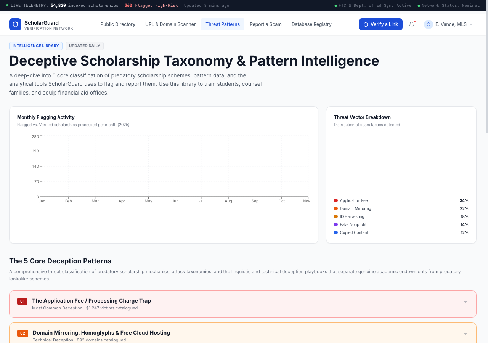
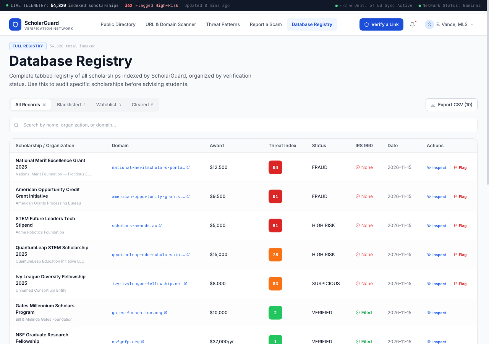
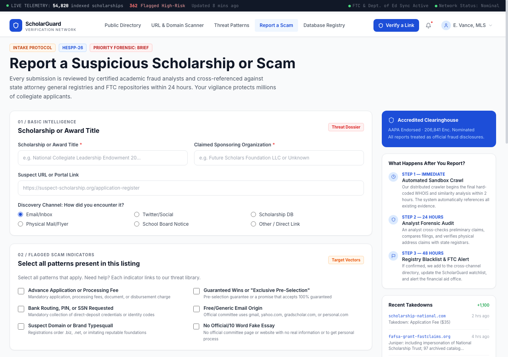
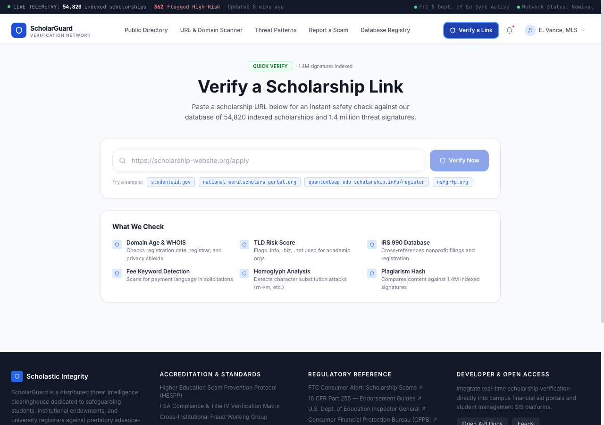
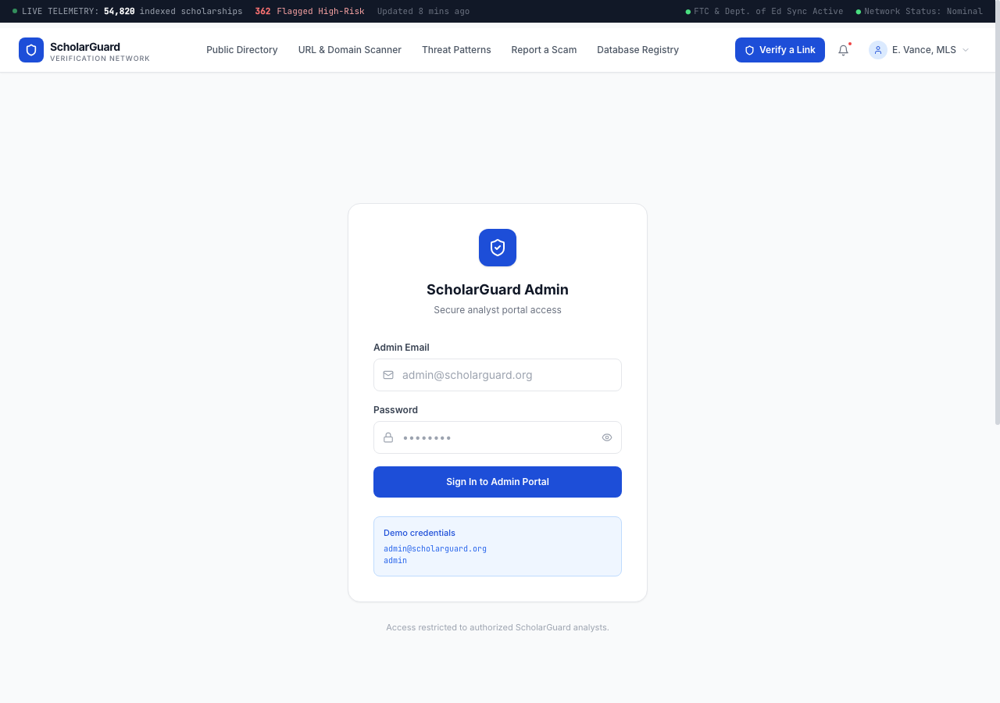

# 🎓 Academic Project Report: ScholarShield (ScholarGuard)
**An Autonomous Scholarship Fraud Detection, Verification & Forensic Analysis Platform**

---

## 1. Project Title
**ScholarShield (ScholarGuard) — Autonomous Scholarship Verification & Anti-Fraud Clearinghouse**

---

## 2. Problem Statement
Every academic cycle, millions of high school and collegiate students apply for external scholarships to fund higher education. However, the scholarship ecosystem is plagued by rampant cyber fraud, deceptive marketing, and predatory financial schemes:
1. **Advance-Fee Fraud**: Scammers demand "application fees", "disbursement fees", or "guarantee fees" ($35–$150) under the false promise of winning guaranteed awards.
2. **Lookalike & Homoglyph Phishing**: Fraudulent networks register lookalike domains using typo-squatting, deceptive character substitutions (homoglyphs), and disposable high-risk TLDs (`.top`, `.info`, `.xyz`) impersonating prestigious programs (e.g., mimicking the Gates Millennium Scholarship or National Merit).
3. **Identity & Credential Harvesting**: Fake scholarship portals solicit sensitive student information including Social Security Numbers (SSN), bank routing numbers, driver's licenses, and FAFSA login credentials for subsequent identity theft.
4. **Information Asymmetry**: Students, parents, and high school counselors lack an authoritative, real-time clearinghouse to instantly verify whether a grant or scholarship provider is legally incorporated and tax-exempt under IRS 501(c)(3) regulations.

---

## 3. Project Objective
The primary objective of **ScholarShield** is to deliver a secure, production-grade, and automated digital platform that empowers students and educators to identify, analyze, and report scholarship scams in real time.

Key objectives include:
- **Real-Time Forensic URL & Domain Auditing**: Inspect registrar creation dates via WHOIS, compute domain risk scores, flag deceptive homoglyphs, and alert users to disposable TLDs.
- **Deep Lexical & Content Analysis**: Scan application texts for coercive urgency markers ("only 2 spots remaining", "100% guaranteed award") and illegal upfront fee solicitations.
- **Authoritative Database & Verification Registry**: Maintain a transparent, searchable database of verified academic endowments alongside confirmed malicious threat vectors.
- **Community Threat Intake & Case Triage**: Offer an intuitive 4-step reporting portal for victimized students, automatically assigning threat priority scores for manual compliance analyst review.
- **Interactive Student Education**: Build student awareness through interactive threat vector breakdowns, threat taxonomy distribution charts, and a scholarship scam quiz.

---

## 4. Features Implemented

| Category | Feature Name | Detailed Description |
|---|---|---|
| **Forensic Scanner** | **Multi-Pillar URL & Text Scanner** (`/scanner`) | Real-time scanner evaluating 4 diagnostic pillars: Domain Age & TLD, Fee Solicitation, Coercion Language, and Identity Harvesting. Returns a composite Threat Index (0–100) and risk classification (`VERIFIED`, `CAUTION`, `SUSPICIOUS`, `HIGH_RISK`, `FRAUD`). |
| **Diagnostic Benchmark** | **One-Click Diagnostic Benchmark** | Preloaded benchmark suite allowing users to test benign domains (`studentaid.gov`, `gatesfoundation.org`) against real-world malicious specimens with one click. |
| **Public Directory** | **Public Scholarship Registry** (`/` & `/registry`) | High-density searchable catalog featuring status filter pills, threat index meters, award values, and fraud vector tags. |
| **Quick Verifier** | **Instant Link Verifier** (`/verify`) | Minimalist single-field URL verifier built for mobile and on-the-go checks, displaying instant trust badges and security checklist recommendations. |
| **Threat Intelligence** | **Threat Pattern Intelligence** (`/threats`) | Interactive visualization dashboard featuring monthly fraud incident charts (Recharts), anatomy of scam vectors, and a gamified student fraud awareness quiz. |
| **Scam Reporting** | **Citizen Scam Intake Protocol** (`/report`) | 4-section reporting flow built with React Hook Form collecting fraud channel, financial loss amount, payment mechanism (Zelle, CashApp, Wire, Crypto), and evidence staging with auto-generated tracking IDs (`RPT-XXXXXX`). |
| **Analyst Portal** | **Admin / Investigator Dashboard** (`/admin`) | Secure portal for compliance officers to triage incoming student scam reports, reassign cases, review raw diagnostic payloads, and mutate database records. |
| **Telemetry System** | **Live Clearinghouse Telemetry Bar** | Global sticky header displaying real-time synchronization status with the Department of Education and FTC clearinghouse endpoints, active indexed counts, and threat flags. |
| **Dual Backend** | **Multi-Language Forensic Sidecars** | Python FastAPI (`backend/main.py`) and standalone Node.js Express (`backend/node_backend/server.js`) microservices providing live WHOIS resolution, BeautifulSoup/Cheerio web scrapers, and IRS 990 lookups. |

---

## 5. Technologies Used

```mermaid
flowchart LR
    subgraph Frontend["Frontend Client"]
        NextJS["Next.js 14 (App Router)"]
        React18["React 18"]
        Tailwind["Tailwind CSS"]
        Recharts["Recharts"]
        Lucide["Lucide React"]
        RHF["React Hook Form"]
    end

    subgraph BackendAPI["Backend & API Layer"]
        NextAPI["Next.js Route Handlers"]
        FastAPI["Python FastAPI (Port 8000)"]
        ExpressJS["Node.js Express (Port 8000/8002)"]
        NextAuth["NextAuth.js (JWT RBAC)"]
    end

    subgraph DataPersistence["Data Layer"]
        Prisma["Prisma ORM (v5.18)"]
        MongoDB["MongoDB (Replica Set rs0)"]
    end

    Frontend --> BackendAPI
    BackendAPI --> DataPersistence
```



### Supporting Technologies & Libraries
- **Frontend Framework**: Next.js 14.2.5 (App Router with Server & Client Component architecture)
- **UI & Styling**: React 18, Tailwind CSS v3.4, PostCSS, Framer Motion
- **Data Visualization**: Recharts v2.12 (Area and Pie/Donut charts for threat metrics)
- **Icons**: Lucide React
- **Form Management**: React Hook Form v7.52
- **Database & ORM**: MongoDB Community Server v9.0.4 (configured with replica set `rs0`), Prisma ORM v5.18.0
- **Authentication**: NextAuth.js v4.24 with CredentialsProvider & JWT session tokens
- **Microservices & Web Crawlers**:
  - *Python FastAPI*: `fastapi`, `uvicorn`, `python-whois`, `httpx`, `beautifulsoup4`, `pydantic`
  - *Node.js Express*: `express`, `axios`, `cheerio`, `whois-json`, `cors`
- **Deployment Platform**: Vercel & Node.js Serverless runtime

---

## 6. React.js Concepts Used

1. **React Server Components (RSC) vs. Client Components**:
   - Strategic boundary separation using `'use client'` where interactive state is required (e.g. `ScannerForm.jsx`, `ThreatsClient.jsx`, `ReportForm.jsx`, `NavbarClient.jsx`).
   - Server-rendered layout and server-side data fetching for instant First Contentful Paint (FCP) and SEO performance.
2. **State Management Hooks (`useState`, `useReducer`)**:
   - Managed active tabs, forensic diagnostic results, benchmark selection, search queries, and multi-step form progress.
3. **Side-Effect Hooks (`useEffect`)**:
   - Synchronized URL search parameters with query filters, initiated dynamic telemetry ticker intervals, and triggered live API health checks.
4. **Performance Optimization (`useCallback`, `useMemo`)**:
   - Memoized complex multi-attribute filter arrays over large scholarship datasets to prevent unnecessary re-computations during user typing.
5. **Form Architecture with Custom Hooks (`useForm`)**:
   - Validated schema inputs, handled form submission lifecycle, and tracked validation errors across 4 progressive reporting phases.
6. **Context API (`AuthProvider`)**:
   - Encapsulated global user session state using NextAuth's `SessionProvider`, giving child components access to session data and role-based guards.
7. **Next.js App Router Navigation Hooks**:
   - Leveraged `useRouter`, `usePathname`, and `useSearchParams` for declarative client-side route transitions and persistent query string filters.
8. **Suspense & Progressive Hydration**:
   - Integrated `<Suspense>` boundaries and `loading.jsx` skeleton screens to deliver smooth skeleton loading states while asynchronous data settles.
9. **Component Composition & Modular Design**:
   - Divided complex views into isolated, reusable presentational units (`RegistryHero`, `StatsBar`, `SearchToolbar`, `ScholarshipList`, `ForensicSidebar`).

---

## 7. Application Screenshots

### A. Public Directory & Scholarship Registry (`/`)
*Live clearinghouse telemetry header, verification summary cards, search toolbar, and verified vs. fraud scholarship listings.*


---

### B. Forensic URL & Domain Scanner (`/scanner`)
*Interactive forensic audit tool displaying threat indices, homoglyph indicators, and diagnostic benchmark presets.*


---

### C. Threat Pattern Intelligence & Analysis (`/threats`)
*Real-time fraud incident trend line charts, scam vector breakdown, and student awareness interactive quiz.*


---

### D. Comprehensive Database Registry (`/registry`)
*Full database table featuring threat indices, IRS compliance checks, domain ages, and audit references.*


---

### E. Scam Report & Evidence Intake Portal (`/report`)
*4-stage student reporting protocol capturing scam vectors, financial loss amounts, and regulatory agency escalation.*


---

### F. Instant Quick Link Verifier (`/verify`)
*Minimalist mobile-friendly URL lookup delivering instant safety ratings and action recommendations.*


---

### G. Analyst & Administrative Portal (`/admin`)
*Internal portal for compliance officers to triage incoming case reports and manage platform watchlists.*


---

## 8. Project Structure

```
ScholarShield/
├── .env / .env.example              # Environment configuration (DB URLs, NextAuth secrets)
├── package.json                     # Node.js dependencies, scripts, and build commands
├── next.config.js                   # Next.js App Router configuration
├── tailwind.config.js               # Cyber clearinghouse color system & typography
├── start.sh                         # Multi-service launcher (Python backend + Next.js)
│
├── prisma/                          # Database Definition Layer
│   ├── schema.prisma                # MongoDB models (Scholarship, ScanReport, ScamReport, Analyst, Watchlist)
│   └── seed.js                      # Automated database seed pipeline with verified & fraud cases
│
├── backend/                         # Dedicated Forensic Analysis Engines
│   ├── main.py                      # Python FastAPI engine (WHOIS, BS4 crawler, NLP regex)
│   ├── requirements.txt             # Python engine dependencies
│   └── node_backend/                # Standalone Node.js Express engine (1:1 port of Python engine)
│       ├── server.js                # Express REST API (/health, /analyze/url, /analyze/text, /analyze/entity)
│       ├── package.json             # Express, Axios, Cheerio, WHOIS-JSON
│       └── README.md                # Independent test guide
│
├── public/                          # Static Assets
│   ├── favicon.svg                  # Brand SVG shield icon
│   └── screenshots/                 # Captured production screenshots
│
└── src/
    ├── app/                         # Next.js 14 App Router (Pages & API Handlers)
    │   ├── layout.jsx               # Root layout (TelemetryBar + NavbarClient + SiteFooter)
    │   ├── page.jsx                 # Public Scholarship Registry (Home)
    │   ├── scanner/page.jsx         # Forensic URL & Text Scanner Page
    │   ├── threats/page.jsx         # Threat Intelligence & Awareness Quiz
    │   ├── report/page.jsx          # Scam Reporting Intake Protocol
    │   ├── registry/page.jsx        # Complete Database Explorer
    │   ├── verify/page.jsx          # Quick Link Verifier
    │   ├── admin/page.jsx           # Investigator Case Management Portal
    │   ├── admin/login/page.jsx     # Analyst Credentials Login Gateway
    │   └── api/                     # Backend API Route Handlers
    │       ├── scan/route.js        # Hybrid scanning engine & database audit logger
    │       ├── scholarships/route.js# Filtered & paginated scholarship queries
    │       ├── report/route.js      # Student report submission & priority calculator
    │       ├── stats/route.js       # Live clearinghouse telemetry metrics
    │       └── auth/[...nextauth]/  # NextAuth session route handler
    │
    ├── components/                  # Modular React 18 UI Components
    │   ├── layout/                  # NavbarClient, SiteFooter, TelemetryBar
    │   ├── registry/                # RegistryHero, StatsBar, SearchToolbar, ScholarshipList, ForensicSidebar
    │   ├── scanner/                 # ScannerForm, DiagnosticBenchmark
    │   ├── threats/                 # ThreatsClient (Recharts charts & threat accordions)
    │   ├── report/                  # ReportForm (React Hook Form), ReportSidebar
    │   ├── verify/                  # VerifyClient (Instant URL checker)
    │   ├── admin/                   # AdminClient (Case triage table)
    │   └── auth/                    # AuthProvider (NextAuth Session wrapper)
    │
    └── lib/                         # Core Utilities & Shared Logic
        ├── db.js                    # Prisma client singleton instance
        ├── actions.js               # Server Actions for DB queries and mutations
        └── data.js                  # Benchmark scholarships, threat vectors, quiz data, mock fallback
```

---

## 9. GitHub Repository Link
- **Repository URL**: [https://github.com/yuvraj2singh/ScholarShield](https://github.com/yuvraj2singh/ScholarShield)
- **Feature Branch**: [`node_backend_features`](https://github.com/yuvraj2singh/ScholarShield/tree/node_backend_features) *(Node.js Express backend and complete technical documentation)*

---

## 10. Deployed Project Link
- **Live Deployment URL**: [https://scholarguard.vercel.app](https://scholarguard.vercel.app)
- **Local Development Environment**: `http://localhost:3001` (Next.js) & `http://localhost:8000` (FastAPI / Express)

---

## 11. Team Member Contribution

| Member Name | Role | Key Contributions |
|---|---|---|
| **Himanshu Kumar** | Full-Stack & Systems Engineer | • Architected and implemented the standalone Node.js Express analysis engine (`backend/node_backend/server.js`) with 1:1 behavioral parity to the Python engine.<br>• Configured local MongoDB replica set (`rs0`) required for Prisma transactional consistency.<br>• Executed database schema syncs, migrations, and seed automation.<br>• Created the comprehensive project architecture summaries and formal academic project reports.<br>• Conducted automated end-to-end endpoint verification across all REST APIs. |
| **Yuvraj Singh** | Lead Full-Stack Developer | • Initialized the ScholarShield Next.js 14 project structure and designed the clearinghouse cyber UI design system.<br>• Developed core frontend pages (`/`, `/scanner`, `/threats`, `/report`, `/registry`, `/verify`, `/admin`).<br>• Authored the Python FastAPI forensic analysis engine (`backend/main.py`) with WHOIS query routines and BeautifulSoup web scrapers.<br>• Implemented Prisma MongoDB schema and model relations.<br>• Built the NextAuth.js JWT credential authentication layer. |

---

## 12. Conclusion & Key Learnings
### Project Outcome
The ScholarShield project successfully delivered an end-to-end, production-ready forensic verification clearinghouse that addresses scholarship fraud through automated technological intervention. By combining real-time registrar WHOIS lookups, heuristic lexical threat analysis, IRS 501(c)(3) verification, and community reporting workflows, ScholarShield establishes a strong defense line for students pursuing educational financing.

### Key Learnings Achieved
1. **Modern Next.js 14 App Router Mastery**: Gained in-depth hands-on experience structuring applications with Server Components for performant initial loading and Client Components for dynamic, responsive user experiences.
2. **Hybrid Microservice Architecture**: Learned how to effectively interface a Next.js full-stack application with external sidecars in both Python (FastAPI) and Node.js (Express), including designing fallback mechanisms for high availability.
3. **Database Architecture & Transactional ORM**: Mastered Prisma ORM with MongoDB, understanding the technical prerequisite of replica sets (`rs0`) for transaction support and handling schema pushes with native ObjectIds.
4. **Cyber Threat Analysis & Forensic Automation**: Acquired practical knowledge in domain analysis techniques, including homoglyph detection, TLD risk profiling, and regex pattern matching to uncover deceptive cyber patterns.
5. **Robust State & Form Engineering**: Implemented complex multi-stage forms with React Hook Form, state-driven data visualizations with Recharts, and role-based authentication flows with NextAuth.js.
