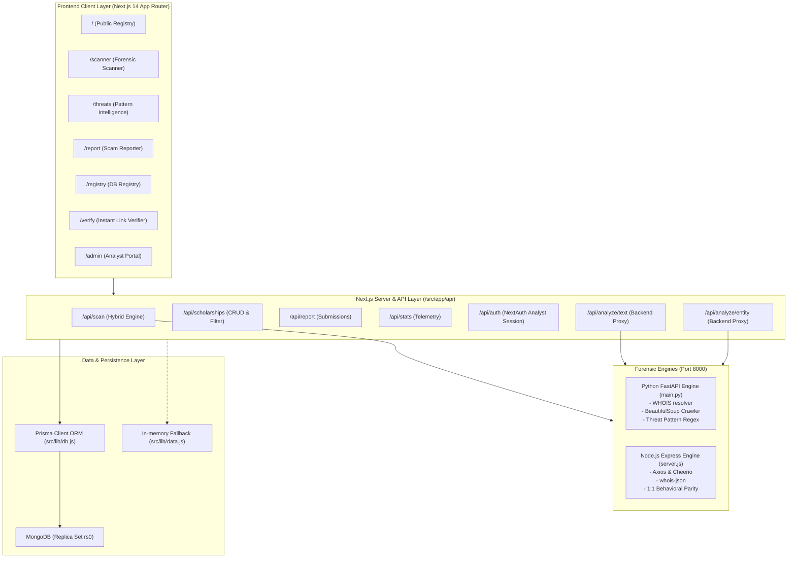

# 🛡️ ScholarGuard (ScholarShield) — Complete Project Architecture & Codebase Summary

ScholarGuard is a full-stack **Scholarship Fraud Detection, Verification & Forensic Analysis Platform** built to protect students from predatory scams, fake scholarship awards, identity harvesting schemes, and fee traps.

---

## 🏛️ System Architecture

---

## 🗂️ Detailed Directory & File Breakdown

### 1. Root Configuration Files

| File | Purpose |
|------|---------|
| [`package.json`](./package.json) | Defines frontend dependencies (`next@14.2.5`, `@prisma/client`, `recharts`, `lucide-react`, `tailwindcss`, `next-auth`, `framer-motion`, `react-hook-form`). Includes scripts (`dev`, `build`, `start`, `db:push`, `db:seed`, `prisma:generate`). |
| [`package-lock.json`](./package-lock.json) | Locked dependency tree and cryptographic hashes for exact reproducible frontend builds. |
| [`next.config.js`](./next.config.js) | Next.js runtime configuration. |
| [`tailwind.config.js`](./tailwind.config.js) | Tailwind CSS theme configuration (custom color palettes for cyber/forensic UI, alerts, and typography). |
| [`postcss.config.js`](./postcss.config.js) | PostCSS plugins (`tailwindcss`, `autoprefixer`) for CSS processing. |
| [`jsconfig.json`](./jsconfig.json) | Configures path aliases (maps `@/*` to `./src/*`) for clean JavaScript imports. |
| [`.eslintrc.json`](./.eslintrc.json) | Code quality and linting rules extending `next/core-web-vitals`. |
| [`.env.example`](./.env.example) | Template of required environment variables for deployment (`DATABASE_URL`, `ANALYSIS_ENGINE_URL`, NextAuth keys). |
| [`.gitignore`](./.gitignore) | Git exclusions (`node_modules`, `.next`, `venv`, `.env`, build artifacts). |
| [`start.sh`](./start.sh) | Orchestration shell script to launch the Python backend (`:8000`) and Next.js frontend concurrently. |
| [`vercel.json`](./vercel.json) | Vercel deployment instructions and build command specifications. |
| [`README.md`](./README.md) | Official project documentation, 7-day development plan, tech stack table, and feature roadmaps. |
| [`COMPLETION_REPORT.md`](./COMPLETION_REPORT.md) | Architectural audit report tracking delivered capabilities across Days 1–7. |

---

### 2. Database Layer (`prisma/`)

| File | Purpose |
|------|---------|
| [`prisma/schema.prisma`](./prisma/schema.prisma) | MongoDB data models:  • **Scholarship**: Registry of verified and scam scholarships, threat scores, vectors, compliance. • **ScanReport**: Automated forensic scan audit logs and breakdown pillars. • **ScamReport**: Student-submitted fraud reports with review statuses. • **Analyst**: Investigator profiles and assigned case counts. • **Watchlist**: Suspicious domain blacklist. |
| [`prisma/seed.js`](./prisma/seed.js) | Seeding script that populates MongoDB with initial benchmark data (10 verified/fraud scholarships and default compliance analyst). |

---

### 3. Backend Engines (`backend/`)

#### A. Python FastAPI Engine (`backend/`)
| File | Purpose |
|------|---------|
| [`backend/main.py`](./backend/main.py) | High-performance Python analysis engine running on port 8000. Features live WHOIS domain age inspection, asynchronous web scraping with BeautifulSoup, homoglyph attack scoring, peer-to-peer payment detection (Zelle/Venmo/Crypto), and IRS 990 nonprofit lookup. |
| [`backend/requirements.txt`](./backend/requirements.txt) | Python dependencies (`fastapi`, `uvicorn`, `python-whois`, `httpx`, `beautifulsoup4`, `pydantic`, `python-dotenv`). |

#### B. Node.js Express Engine (`backend/node_backend/`) *(Branch: `node_backend_features`)*
| File | Purpose |
|------|---------|
| [`backend/node_backend/server.js`](./backend/node_backend/server.js) | Complete 1:1 Express.js implementation of `main.py` mirroring `/health`, `/analyze/url`, `/analyze/text`, and `/analyze/entity`. Uses `axios`, `cheerio`, and `whois-json`. |
| [`backend/node_backend/package.json`](./backend/node_backend/package.json) | Node engine dependencies and scripts. |
| [`backend/node_backend/README.md`](./backend/node_backend/README.md) | Guide for launching and verifying the standalone Node.js engine on any designated port. |

---

### 4. Shared Libraries (`src/lib/`)

| File | Purpose |
|------|---------|
| [`src/lib/db.js`](./src/lib/db.js) | Prisma client singleton that prevents memory leaks and multiple connections during development hot reloading. |
| [`src/lib/data.js`](./src/lib/data.js) | In-memory mock database of scholarships, threat pattern taxonomies, educational quiz questions, and telemetry statistics. Serves as graceful fallback when DB is disconnected. |
| [`src/lib/actions.js`](./src/lib/actions.js) | Server Actions for pagination, search querying, statistics aggregation, and status updates across the database. |

---

### 5. Next.js API Layer (`src/app/api/`)

| Route | Purpose |
|-------|---------|
| [`src/app/api/scan/route.js`](./src/app/api/scan/route.js) | **Core forensic scanner endpoint**. Executes hybrid analysis: calls external backend engine if active, performs built-in JS regex analysis as redundancy, computes 4 forensic pillars (Domain, Fee, Coercion, Identity), and stores audit logs in DB. |
| [`src/app/api/scholarships/route.js`](./src/app/api/scholarships/route.js) | Handles `GET` requests for paginated, filterable scholarship data with full-text search across names, organizations, and URLs. |
| [`src/app/api/report/route.js`](./src/app/api/report/route.js) | Handles `POST` requests for student scam submissions, calculates risk priority scores, and creates tracking IDs (`RPT-XXXXXX`). |
| [`src/app/api/stats/route.js`](./src/app/api/stats/route.js) | Aggregates live telemetry data: total verified, active takedowns, flag rate, and 24h reports. |
| [`src/app/api/auth/[...nextauth]/route.js`](./src/app/api/auth/[...nextauth]/route.js) | NextAuth handler for role-based analyst login with JWT session management. |
| [`src/app/api/analyze/text/route.js`](./src/app/api/analyze/text/route.js) | Proxies text analysis requests directly to the backend engine on port 8000. |
| [`src/app/api/analyze/entity/route.js`](./src/app/api/analyze/entity/route.js) | Proxies entity verification and IRS 990 queries to the backend engine on port 8000. |

---

### 6. App Router Pages (`src/app/`)

| Page | URL Route | Description |
|------|-----------|-------------|
| [`src/app/layout.jsx`](./src/app/layout.jsx) | Global Layout | Wraps every route with TelemetryBar, NavbarClient, AuthProvider, and SiteFooter. |
| [`src/app/globals.css`](./src/app/globals.css) | Global Styles | Tailwind directives, dark terminal palette, glowing borders, and animations. |
| [`src/app/loading.jsx`](./src/app/loading.jsx) | Global Skeleton | Animated UI skeleton during page transitions and server-side fetching. |
| [`src/app/not-found.jsx`](./src/app/not-found.jsx) | 404 Page | Custom security-themed 404 screen. |
| [`src/app/page.jsx`](./src/app/page.jsx) | `/` | Homepage featuring the Public Scholarship Registry, threat indices, search, and live filter pills. |
| [`src/app/scanner/page.jsx`](./src/app/scanner/page.jsx) | `/scanner` | Forensic Scanner UI for deep URL/Domain audits and diagnostic benchmark presets. |
| [`src/app/threats/page.jsx`](./src/app/threats/page.jsx) | `/threats` | Threat Pattern Intelligence: scam anatomy breakdowns, charts, and interactive awareness quiz. |
| [`src/app/report/page.jsx`](./src/app/report/page.jsx) | `/report` | Scam Reporting portal for students, counselors, and institutions. |
| [`src/app/registry/page.jsx`](./src/app/registry/page.jsx) | `/registry` | Comprehensive searchable table database of all scholarships. |
| [`src/app/verify/page.jsx`](./src/app/verify/page.jsx) | `/verify` | Fast single-field link verification tool for quick checks on the go. |
| [`src/app/admin/page.jsx`](./src/app/admin/page.jsx) | `/admin` | Investigator dashboard for reviewing reported scams, triage, and database management. |
| [`src/app/admin/login/page.jsx`](./src/app/admin/login/page.jsx) | `/admin/login` | Secure login gateway for verified compliance analysts. |

---

### 7. UI Components (`src/components/`)

#### A. Layout (`src/components/layout/`)
- [`NavbarClient.jsx`](./src/components/layout/NavbarClient.jsx): Navigation bar with route highlight indicators, telemetry ticker, and quick scanner button.
- [`SiteFooter.jsx`](./src/components/layout/SiteFooter.jsx): 4-column footer with security advisories, FTC hotlines, and clearinghouse credentials.

#### B. Registry (`src/components/registry/`)
- [`RegistryHero.jsx`](./src/components/registry/RegistryHero.jsx): Banner highlighting verification standards and clearinghouse protocols.
- [`StatsBar.jsx`](./src/components/registry/StatsBar.jsx): 4 live counter metrics cards.
- [`SearchToolbar.jsx`](./src/components/registry/SearchToolbar.jsx): Search input and filter tabs (`VERIFIED`, `SUSPICIOUS`, `HIGH_RISK`, `FRAUD`).
- [`ScholarshipList.jsx`](./src/components/registry/ScholarshipList.jsx): Renders list of scholarship cards with threat badges, vector tags, and compliance details.
- [`ForensicSidebar.jsx`](./src/components/registry/ForensicSidebar.jsx): Active forensic case review panel and 3-step student safety checklist.
- [`RegistryClient.jsx`](./src/components/registry/RegistryClient.jsx): Client wrapper coordinating search state, active tab, and card renderers.
- [`RecentActivity.jsx`](./src/components/registry/RecentActivity.jsx): Real-time activity feed of recently audited domains and takedowns.

#### C. Scanner (`src/components/scanner/`)
- [`ScannerForm.jsx`](./src/components/scanner/ScannerForm.jsx): Interactive input form triggering `/api/scan` with real-time diagnostic visualizer.
- [`DiagnosticBenchmark.jsx`](./src/components/scanner/DiagnosticBenchmark.jsx): Preset sample URLs (e.g. `studentaid.gov`, known fraud domains) for one-click testing.

#### D. Threats (`src/components/threats/`)
- [`ThreatsClient.jsx`](./src/components/threats/ThreatsClient.jsx): Threat distribution charts (Recharts), fraud vector accordions, and student awareness quiz.

#### E. Reporting (`src/components/report/`)
- [`ReportForm.jsx`](./src/components/report/ReportForm.jsx): 4-step scam report form using `react-hook-form` capturing scam channel, amount lost, and payment method.
- [`ReportSidebar.jsx`](./src/components/report/ReportSidebar.jsx): Investigation workflow timeline and regulatory escalation contacts (FTC, CFPB).

#### F. Quick Verifier & Admin (`src/components/verify/` & `src/components/admin/`)
- [`VerifyClient.jsx`](./src/components/verify/VerifyClient.jsx): Fast lightweight URL lookup component showing instant trust badges.
- [`AdminClient.jsx`](./src/components/admin/AdminClient.jsx): Analyst triage table, case reassignment, and status toggle panel.
- [`AuthProvider.jsx`](./src/components/auth/AuthProvider.jsx): NextAuth SessionProvider wrapper for authentication context.

---

### 8. Static Assets (`public/`)
- [`public/favicon.svg`](./public/favicon.svg): Cyber shield brand logo and browser favicon.
